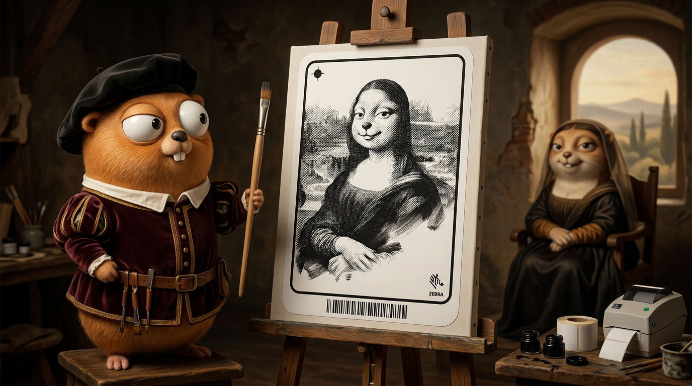

# Go ZebraIMG



A Go library for encoding and decoding black-and-white images to/from Zebra GRF (Graphics Format) ASCII, used by Zebra printers.

Bit convention follows the [ZPL `^GF` specification](https://docs.zebra.com/us/en/printers/software/zpl-pg/c-zpl-zpl-commands/r-zpl-gf.html): **bit 1 = black (print dot), bit 0 = white**.

## Features

- **Encoding**: Convert images to GRF ASCII format
- **Decoding**: Convert GRF ASCII back to images
- **Floyd-Steinberg Dithering**: Optional error diffusion for better image quality
- **Run-Length Compression**: Efficient ASCII encoding using G-Y/g-z notation

## Installation

```bash
go get github.com/fabiomarini/go-zebraimg
```

## Usage

### Basic Encoding

```go
package main

import (
    "fmt"

    "github.com/fabiomarini/go-zebraimg/zebraimg"
)

func main() {
    // Load an image
    img, err := zebraimg.LoadImage("input.png")
    if err != nil {
        panic(err)
    }

    // Encode to GRF (dither=true applies Floyd-Steinberg dithering)
    result, err := zebraimg.EncodeImageToGRF(img, false)
    if err != nil {
        panic(err)
    }

    fmt.Printf("GRF data: %s\n", result.AsciiData)
    fmt.Printf("Dimensions: %dx%d, Bytes per row: %d\n",
        result.Width, result.Height, result.BytesPerRow)
}
```

### Decoding

```go
// Decode GRF back to image
decoded, err := zebraimg.DecodeGRFToImage(result)
if err != nil {
    panic(err)
}

// Save the decoded image
err = zebraimg.SaveImage(decoded, "output.png")
if err != nil {
    panic(err)
}
```

### Using the ZebraGRF struct directly

```go
// Create an encoder for an 80-pixel-wide image (10 bytes per row)
encoder, err := zebraimg.New(10)
if err != nil {
    panic(err)
}

// Encode image
grfString, err := encoder.EncodeImage(img, true)

// Decode back
decoded, err := encoder.DecodeImage(grfString)
```

## GRF Format

The GRF format uses run-length encoding with the following special characters:

| Character | Meaning |
|-----------|---------|
| `G`-`Y` | Repeat next character 1-19 times |
| `g`-`z` | Repeat next character 20-400 times (multiples of 20) |
| `:` | Repeat previous line |
| `,` | Fill rest of line with 0s (white) |
| `!` | Fill rest of line with Fs (black) |

Per the ZPL spec, bit `1` is a black print dot and bit `0` is white, so `,` fills with white and `!` fills with black.

## Testing

```bash
go test ./...
```

## Notes

- **Dithering**: `dither=true` applies Floyd-Steinberg error diffusion, which suits grayscale photos. `dither=false` uses a simple Rec. 601 luma threshold, giving a pixel-for-pixel representation for black-and-white artwork.
- **Decoded width**: GRF rows are whole bytes, so decoding returns an image `BytesPerRow*8` pixels wide — the original width rounded up to a multiple of 8. Padding bits are `0`, which decode as white.

## License

MIT License
